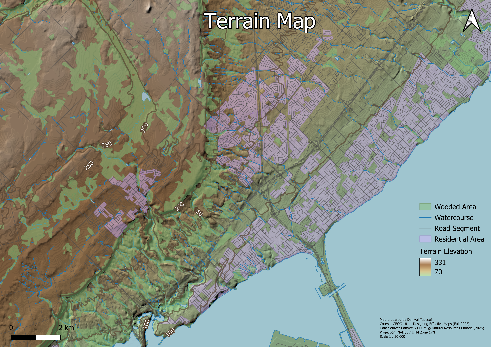
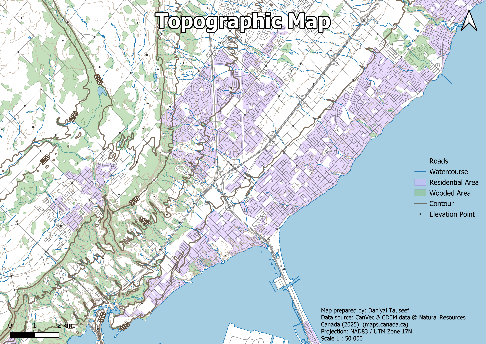

# QGIS Terrain Mapping

A terrain and topographic mapping project of the Hamilton–Burlington area in Ontario, Canada, created in QGIS using Natural Resources Canada elevation and topographic data.



## Project Overview

This project demonstrates how raster and vector geospatial data can be combined to communicate both landform and human geography. Two map products were created at **1:50,000** using **NAD83 / UTM Zone 17N**:

- a **topographic map** emphasizing contours, elevation points, hydrography, roads, residential areas, and wooded areas;
- a **terrain map** combining a digital elevation model (DEM), hillshade, hypsometric tinting, and vector overlays to produce a more intuitive representation of relief.

The work originated as a GEOG 181 cartography project and has been reorganized here as a reproducible GIS portfolio project.

## Tools and Techniques

- QGIS
- Raster and vector GIS
- Digital Elevation Models (DEM)
- Hillshade generation and visualization
- Hypsometric tinting
- Layer transparency and blend modes
- Contour classification and labeling
- GeoPackage data management
- Coordinate reference systems and map projections
- Cartographic layout and visual hierarchy

## Map 1 — Topographic Map



The topographic map focuses on conventional elevation and reference features. It includes:

- contour lines with emphasized and labeled index contours;
- elevation points;
- roads;
- watercourses and waterbodies;
- residential areas; and
- wooded areas.

The map was designed to make elevation values and landscape structure easy to interpret while retaining enough transportation and land-cover context for orientation.

## Map 2 — Terrain Map


The terrain map uses the DEM as the elevation surface and applies a hypsometric colour ramp from lower to higher elevations. A semi-transparent hillshade layer is blended over the DEM to strengthen the perception of relief without obscuring the elevation colours.

Roads, water features, residential areas, wooded areas, and selected contour labels are then overlaid with reduced visual weight so the terrain remains the dominant element of the composition.

## Workflow

1. Loaded CanVec vector layers and Canadian Digital Elevation Model data into QGIS.
2. Selected a 1:50,000 study area in the Hamilton–Burlington region.
3. Styled contour lines and differentiated index contours using the elevation attribute.
4. Added elevation points, hydrography, roads, residential areas, and wooded areas.
5. Built the topographic map layout with title, scale bar, north arrow, legend, projection information, and data attribution.
6. Styled the DEM using a hypsometric colour ramp.
7. Added hillshade using transparency and a multiply blend to create a three-dimensional terrain effect.
8. Integrated vector reference layers over the terrain surface while maintaining visual hierarchy.
9. Exported the final maps as high-resolution PNG files.

## Repository Structure

```text
QGIS-Terrain-Mapping/
├── README.md
├── project/
│   └── terrain-mapping.qgz
├── data/
│   ├── terrain_vectors.gpkg
│   ├── dem.tif
│   ├── hillshade.tif
│   └── README.md
├── images/
│   ├── topographic-map.png
│   └── terrain-map.png
└── docs/
    └── methodology.md
```

For the portfolio version, the seven CanVec vector layers used by the maps were consolidated into a single GeoPackage. This keeps the repository substantially smaller and easier to reproduce than the original course-data folder while preserving the relevant feature geometries and attributes.

## Open the QGIS Project

1. Clone or download this repository.
2. Open `project/terrain-mapping.qgz` in QGIS 3.x.
3. The project uses relative paths and should load the bundled raster and GeoPackage data automatically.

## Data Sources

- **CanVec** — Natural Resources Canada
- **Canadian Digital Elevation Model (CDEM)** — Natural Resources Canada

The source metadata identifies these datasets as available under the **Open Government Licence – Canada**. See [`data/README.md`](data/README.md) for additional details.

## Project Context

Originally completed for **GEOG 181 — Designing Effective Maps** at the University of Waterloo and later reorganized as a standalone geospatial portfolio project.

## Academic Integrity

This repository contains university coursework shared for portfolio review and educational reference only. Copying, redistributing, or submitting this work as coursework is not permitted.

See [ACADEMIC_INTEGRITY.md](ACADEMIC_INTEGRITY.md) for details.
